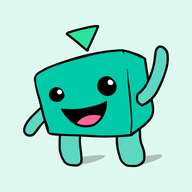

<p align="center">
  
</p>

<h1 align="center">ToonBridge</h1>

<p align="center">
  Turn Adobe Animate (XFL) projects into ToonSquid <code>.tsproj</code> files — right in your browser.<br>
  <b>Repository:</b> <a href="https://github.com/Yahahahau/ToonBridge">github.com/Yahahahau/ToonBridge</a>
</p>

> **ภาษาไทย (สรุป):** ToonBridge คือเว็บแอปแปลงโปรเจกต์ **Adobe Animate / Flash (XFL)** เป็นโปรเจกต์ **ToonSquid (`.tsproj`)** ประมวลผลทั้งหมดในเบราว์เซอร์ ไม่อัปโหลดไฟล์ไปที่ใด
> วางไฟล์ → ตรวจข้อมูลโปรเจกต์ → กด Convert → ดาวน์โหลด `.tsproj` พร้อมรายงานสิ่งที่สูญเสีย/ประมาณค่า
> **สถานะ: ทดลอง (V1)** — ไฟล์ผลลัพธ์ผ่านการตรวจโครงสร้างแล้ว แต่ **ยังไม่เคยยืนยันว่าเปิดในแอป ToonSquid ได้จริง** ดูหัวข้อ [Reliability](#reliability) ด้านล่าง

## What is it?

If you animate in Adobe Animate (formerly Flash) and want to continue in ToonSquid, you'd normally redraw everything. ToonBridge reads your Animate project, understands its drawings, symbols, keyframes and motion tweens, and writes a ToonSquid project file you can open and keep working on.

- **Private by design.** Everything runs in your browser. Your project is never uploaded.
- **Honest.** Nothing is dropped silently. Every conversion ends with a report listing what was converted, what was approximated, and what couldn't be converted.
- **Checked before you download.** The output is read back and validated (ZIP, SQLite schema, references, frame ranges…). If the check fails, the download is blocked.
- **Repeatable.** The same input always produces byte-identical output.

## How to use it

1. Open the app and **drop** your project onto the import area (or click to browse).
   Supported: a **ZIP of an XFL project**, or a **ZIP-based `.fla`** (tested with a project saved from Animate 22).
2. Check the project summary (canvas, frame rate, scenes, symbols, keyframes, tweens).
3. Choose how skewed parts should be handled, then press **Convert**.
4. **Download** the `.tsproj`, open it in ToonSquid, and read the **conversion report**.

Older binary `.fla` files (Flash 5 – CS4) are detected but not converted directly: see [Legacy binary FLA](#reliability) for two ways to turn them into XFL first.

## The app

A GitHub-style workspace in ToonBridge's mint-teal identity: header (theme menu, settings, source link), a sidebar with **Convert**, **Conversion history**, **Settings** and **About**, and a Convert page with *Overview / Project details / Report* tabs. Light and dark themes (or *Match system*) come from one set of design tokens. History stores only names, dates and results in this browser; converted files can be re-downloaded during the same visit. Settings hold the default skew mode, seam hiding and whether to keep history.

## Reliability

ToonSquid's file format isn't publicly documented, so everything here is derived from real files made by the app. The status of each part is stated plainly:

| Status | What |
| --- | --- |
| **Structure-verified** (matches app-made files and is re-checked by the validator) | ZIP/SQLite structure and schemas, vector node layout, frame ranges, layer/drawing/clip references |
| **Experimental** (inferred, not yet confirmed inside ToonSquid) | Clip-instance transforms, motion-tween easing, z-order, stroke `jS/cS`, **native symbol playback** (the clip *Time* track), **skew via the Perspective effect**, **seam hiding**, and — most importantly — **opening a generated file in the app** |
| **Not converted** (always reported) | Inner shadows/glows, bevels, tint/advanced colour effects, Invert/Alpha/Erase blends (see [Filters & effects](#filters--effects-animate-vs-toonsquid)), masks, gradient/bitmap fills, text, audio/video, shape tweens, legacy binary FLA (detected and explained, see below) |

**Skew.** ToonSquid has no skew in its transform, so skewed instances are converted with its *Perspective* effect (layer type 121 + corner offsets), whose layout was decoded from an app-made sample. Rendering the written file back matches Animate's own matrices (mean error ≈ 7×10⁻⁵, versus 1.8×10⁻² when skew is ignored), but that only proves the encode/decode maths agree — **not** that ToonSquid interprets the effect the same way. Two safer alternatives are available in the UI: *Bake into paths* (exact, larger file) and *Ignore skew*.

**Safeguards built into the converter** (each one is reported when it fires):
- *Tween guard*: every baked motion tween must land exactly (≤ 0.05 px) on both of its keyframes; if the model can't reproduce one, the tween is held at its start keyframe instead of producing a jumping in-between.
- *Symbol-swap tweens* are held (below).
- *Movie clip continuity*: a movie clip that stays on its layer across several keyframes (same symbol) keeps playing from where it was, like the same instance in Animate, instead of restarting at every keyframe (that restart made `retry brain loop movie` and BF's miss overlays stutter).
- *Blend isolation*: a symbol whose own content uses blend modes is written as an isolated group (ToonSquid **Normal**, `bM 0`) instead of the default **Pass Through**, so its blends stay inside the symbol. Without this, BF's miss poses (Hard Light layers) blended against the white Background and came out washed-out lavender.
- *Verified encoding first*: skew is **baked into the paths** by default (exact geometry); the Perspective-effect mode stays available but is marked experimental.

**Tweens between different symbols** (a classic tween whose end keyframe holds another symbol, e.g. Animate's auto-made `Tween 13` → `BF sing face ye`) are held at the start keyframe instead of being interpolated: interpolating mixes two unrelated registration points and threw parts of the character out of place for a frame.

**Library names** are the symbol's own name; extra snapshots of the same symbol are `name 2`, `name 3`, …

**Seams.** ToonSquid draws each fill on its own and anti-aliases its edges, so where two colours touch (or a colour meets a black outline on another layer) a hairline of background can show when you zoom in. Animate artwork often also has gaps under 0.5px between the colour layer and the outline. ToonBridge hides both with thin underlay strokes drawn **below** the fills:
- along edges shared by two fills of one shape (in the darker colour), and
- along the parts of a fill's outline that are hidden under opaque fills on the layers above it in every frame where it is shown (a 0.5px bleed in the fill's own colour, trimmed at the ends).

Visible edges stay where Animate put them: against an 8× supersampled Animate reference, the only pixels that change are the seams and those sub-pixel gaps. Hiding is on by default and can be switched off in the UI (*Hide hairline seams*). It makes files bigger (about +25% on the Boyfriend sample).

**Held drawings.** Like ToonSquid's own timeline, a picture that doesn't change is **one drawing held over several frames** (`s..e`), not a new drawing per frame. Frames of a symbol that look the same (a held keyframe, a loop landing on the same picture) share one snapshot clip, so the drawing that shows them can be held too. On the Boyfriend sample: 484 → 205 clips, 171 → 68 scene drawings, 97 → 53 MB, and all 26 frames render pixel-identical to before.

**Animated symbols as clips** (default). Each animated symbol becomes **one clip with all of its frames**, like a symbol in the Animate library, and plays inside a symbol layer of the parent timeline. A run of frames where the symbol simply plays on (+1 frame each frame, looping) is one drawing; its clip *Time* (start frame) is written as a `ti` keyframe track. Held frames and frames with baked skew still use a still snapshot. On the Boyfriend sample: 204 → 85 clips (27 with real animation), 68 → 8 scene drawings, 50.9 → 39.4 MB, and all 26 frames render pixel-identical to snapshot mode. Not yet confirmed in the app: how ToonSquid counts *Time*. If playback looks shifted, turn off *Animated symbols as clips* to get the old snapshot output.

**Legacy binary FLA (Flash 5, MX, MX 2004, 8, CS3, CS4).** These are OLE2 compound files, not ZIP. ToonBridge reads the container safely (size, chain-loop and range limits), reports the Flash version and stream counts, and stops with instructions instead of guessing. To convert one today:
1. Open it in Animate and *Save As* `.fla` (CS5+) or `.xfl`, **or**
2. Use [JPEXS FLA Convert](https://github.com/jindrapetrik/jpexs-fla-convert) (LGPL-2.1, Java): `convert --format CS6 --container xfl old.fla outdir`, then zip the folder and drop it in.

Route 2 was tested on two CS4 files: both convert, keep names and keyframe animation, and frame 1 matches the XFL reference. JPEXS reports two losses: zero-length frames become 1 frame, and pages not linked to the library are skipped. Other Flash versions are untested (no sample files yet).

Other limits: conversion runs on the main thread (big projects freeze the page briefly).

## Filters & effects: Animate vs. ToonSquid

Researched from Adobe's *Graphic filters* / *Applying blend modes* pages and ToonSquid's Handbook (*Effects*, *Blend Modes*). Logic: `src/engine/effects/plan.ts`.

| Adobe Animate | ToonSquid (row in the file) | How it maps | Written? |
| --- | --- | --- | --- |
| Blur (Blur X/Y, quality) | Gaussian Blur (type 100, `r`) | box blur → r = 2σ, σ = √(q·(size²−1)/12); X≠Y uses the larger | **yes** |
| Adjust Color (brightness, contrast, saturation, hue) | Adjustments (type 104, `b c s h` = value ÷ 100) | 1:1 | **yes** |
| Drop Shadow (blur, distance, angle, colour, strength) | Drop Shadow (type 101, `r`, `os:[x,y]`, `c`) | offset = distance·(cos, sin)(angle); ToonSquid shadow colour has no alpha | **yes** |
| Glow (outer) | Drop Shadow with `os:[0,0]` | as above | **yes** |
| Drop Shadow / Glow *inner*, Bevel, Gradient Glow, Gradient Bevel | — | no equivalent | reported as lost |
| Colour effect: Alpha | layer opacity `op` | 1:1 | **yes** |
| Colour effect: Brightness | Adjustments brightness | curve differs | **yes** (approx.) |
| Colour effect: Tint, Advanced | — | no equivalent | reported as lost |
| Blend: Normal, Layer | Normal (no `bM`) | 1:1 | **yes** |
| Blend: Darken, Multiply, Lighten, Screen, Overlay, Hard Light, Difference, Add, Subtract | `bM` = 2, 3, 7, 8, 12, 14, 19, 10, 21 | by name; `bM` = index in ToonSquid's blend list | **yes** |
| Blend: Invert, Alpha, Erase | — (Alpha/Erase are masking in ToonSquid) | no equivalent | reported as lost |
| Skew (transform) | Perspective (type 121) | R8 | **yes** (experimental) |

Encodings were read from an app-made probe file (`scripts/decode-effects.ts`). Filters and blend modes sit on the **symbol layer** (type 4); the probe showed effects on shape layers and `bM` on shape/vector layers, so placing them on symbol layers is an inference: please check in the app. Blur radius scale (2σ) and hue units are not yet calibrated against a render.

ToonSquid also has effects Animate doesn't (Pixelate, Sharpness, Halftone, Noise, Chroma Key, Turbulent Displace, Warp, Mesh, Bones, Stroke, Spin, Parallax, Orient Along Motion Path), so there's nothing to convert into them.


## Run it locally

```bash
npm ci
npm run dev          # dev server
npm test             # unit tests + synthetic end-to-end conversion
npm run build        # typecheck + production build -> dist/
npm run check:icons  # validate icons, manifest and every URL in dist/ (also under a sub-path)
```

Tests against real files (not committed — they're third-party artwork):

```bash
A2T_FIXTURES=/path/to/folder npm test     # see tests/fixtures/README.md
npx tsx scripts/convert-cli.ts in.fla out.tsproj          # convert from the command line
npx tsx scripts/render-preview.ts out.tsproj 1 f1.svg     # render a frame back from a written file
npx tsx scripts/compare-skew.ts in.fla outDir             # Animate reference vs. ignore / Perspective / bake
```

## Deploy

- **GitHub Pages:** `.github/workflows/pages.yml` runs tests, builds, checks the icons and publishes `dist/`. Enable it once under *Settings ▸ Pages ▸ Source: GitHub Actions*.
- **Netlify:** `netlify.toml` is ready (`npm run build`, publish `dist`, cache headers for icons and the manifest).
- The build uses relative paths (`base: './'`), so it works at a domain root or under a sub-path such as `/ToonBridge/`. There are no API keys or secrets.
- Icons and the manifest get a `?v=<hash>` suffix at build time, so a redeploy is picked up even by browsers (and GitHub Pages' cache) that hold on to favicons. There is no service worker, so nothing can serve a stale app shell.

## Icons & install-to-home-screen

Icons are generated from the approved mascot artwork in `brand/` by `scripts/make-icons.py` (`npm run icons`), and checked by `scripts/check-icons.mjs`:

| File | Size | Used for |
| --- | --- | --- |
| `favicon.svg`, `favicon.ico` (16/32/48), `favicon-16x16.png`, `favicon-32x32.png` | — | Browser tabs, bookmarks |
| `apple-touch-icon.png` (180), `-167`, `-152` | opaque | iPhone / iPad Home Screen |
| `icon-192.png`, `icon-512.png` | solid background | Android / PWA (`any`) |
| `icon-maskable-512.png` | safe-zone artwork | Android adaptive icons (`maskable`) |
| `icon-master.png` | 1024×1024 | Source for the above |

Automated checks cover file sizes, PNG/ICO/SVG validity, manifest JSON, and that every referenced URL returns 200 at both `/` and `/ToonBridge/`. **Not yet tested on real devices:** Safari on iPhone/iPad, Android Home Screen install, and PWA install prompts.

## Mascot (prepared, not active)

The UI has a reserved spot for an animated mascot driven by a **spritesheet + Sparrow/Starling XML** (`src/mascot/`). It draws nothing until you add assets to `public/mascot/` and set `MASCOT_SOURCE` in `src/mascot/config.ts`; it never invents animation names or triggers. Rotated atlas frames are not supported yet and are reported as an error rather than guessed.

## Architecture

```
src/engine/            No React — runs in the browser and in Node
  zip/reader.ts        Tolerant ZIP reader (central directory, else local-header scan; ZIP64)
  zip/writer.ts        Stored ZIP64, like the app writes (deterministic)
  xfl/edges.ts         R1/R2  twips, quad→cubic, `cubics` attribute
  xfl/parse.ts         XFL → IR (ir.ts)
  geometry/            R3 contours per fill style, bounds, perspective (skew) maths, cover.ts (R9 seam hiding)
  resolver/resolver.ts R4–R9  frame ranges, instance transforms, symbol snapshots, tween baking, skew
  tsproj/writer.ts     IR → SQLite (sql.js/WASM) + ZIP
  tsproj/validator.ts  9 checks, reading the output back from its bytes
  report.ts            What is verified / experimental / unsupported
src/ui/, src/App.tsx   Interface (React)   ·   src/mascot/   Spritesheet mascot component
```

**Rules (short).** R1 `#HEX.FF`/twips ÷ 20 → px · R2 use `cubics` if present, else quad→cubic (2/3) · R3 one contour set per fill style · R4 `s = index+1`, `e = index+duration` · R5 `pv = transformationPoint`, `p = M·tp`, `rot = atan2(b,a)`, `sx = √(a²+b²)`, `sy = det/sx` · R6 graphic loop / play once / single frame → pick the symbol frame; symbol frames with identical content share one clip so drawings are held (`s..e`) · R7 deterministic output (UUIDv5 ids, fixed ordering and dates, 4-decimal rounding, stored ZIP) · R8 skew `h = (a·c+b·d)/(a²+b²)`, `M = R·S·[[1,h],[0,1]]`, pivot `pv = A·tp`, Perspective corners `c = (h·y)/width` · R9 seams: 1px underlay strokes below fills, on shared edges (darker colour) and on outline parts covered by opaque fills above (own colour, sample offset 0.45px outward at t = 0.2/0.5/0.8, ends trimmed 0.5px).

## Credits

ToonBridge is an independent, unofficial tool. ToonSquid and Adobe Animate belong to their respective owners.
