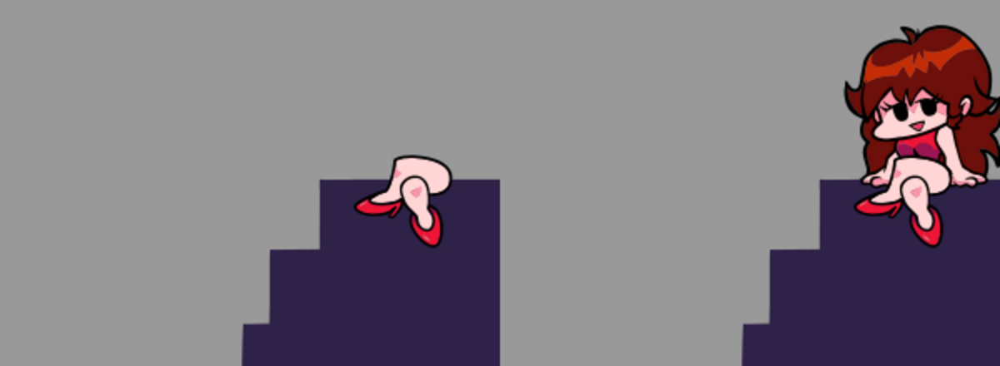

# Phase B2 — JPEXS Legacy FLA Timeline Preservation (F1)

Date: 2026-11-22 · Branch `fix/jpexs-zero-duration-frames` (from `fix/locatable-diagnostics` @ `06e373d`) · Scope: F1 only.

**Not done here** (per the brief): reverse loops, gradients, masks, text, audio, or any other conversion feature.

## 1. Result

- **All 37 known timing problems are resolved.**
  - On both test files, every keyframe of every layer of every linked page now has exactly the start and duration stored in the binary FLA records. That is 0 mismatches over all layers, not only the 37.
  - The 37 layers start their art on frame 1 again.
  - Each affected symbol has its source length again (e.g. `GF Dancing Beat` 30, not 31).
- **No artwork is removed.**
  - Old vs patched XFL have identical counts of symbol instances (BF 258, GF 95), shapes (121, 17) and edges (337 306, 4 720).
  - The only frames removed are the 37 empty zero-length frames (BF 33, GF 4).
  - Only the 11 + 2 affected symbol files differ.
- **JPEXS's own report now appears in the ToonBridge report.** It has its own section and codes (`JPEXS_*`), with location and outcome.
- **XFL-only conversion is byte-identical.** The `Boyfriend_But_Better` sha1 `dca54e90…` and the earlier BF/GF XFL outputs are unchanged; the report import only adds diagnostics.
- **Not verified:**
  - Visual checks use ToonBridge's own renderer, not ToonSquid.
  - Only Flash CS4 inputs were available.
  - No zero-length frame **with content** exists in the real files. That case is covered by a synthetic fixture only, and its Flash semantics are unconfirmed (section 2).



*GF frame 1, rendered from the `.tsproj` by ToonBridge's own renderer. Left: old JPEXS output, where only the legs show because 3 of 5 layers start one frame late. Right: patched.*

## 2. Root cause

- **The cause is serialization, not parsing.**
  - The JPEXS binary reader keeps the stored value (`duration = 0`), so the original timing is still available.
  - The XFL export stage, `BinaryFlaToXflExporter.Session.layer()`, did this:

    ```java
    long duration = n(frame, "duration", 1);
    if (duration <= 0) { issue("FRAME_DURATION", frame, "Zero duration replaced with one frame."); duration = 1; }
    frame(frames, frame, start, duration);
    start += duration;            // start = sum of earlier durations
    ```

  - Widening to 1 moves the `start` of every later frame on the layer by +1. Other layers of the same symbol do not move, so they desynchronise, and the symbol gets one frame longer.
- **The 37 real cases.** Read straight from the binary records with `scripts/audit/SourceTimelines.java`, all 37 are:
  - the **first** frame of a layer,
  - **empty** (no children, no frame shape, no script, label or sound, no tween; `keyMode` 9728),
  - followed by real frames.
- **Meaning.** A zero-length frame occupies no time. The source layer ends prove it: with zero-length frames counted as 0, every layer of `GF Dancing Beat` ends at 30, matching layers 1 and 5, which have no zero-length frame.
- **Other zero-duration cases:**
  - **Zero-length frames with content:** none in our files. The patch keeps them, as before, and reports the shift, because no content may be deleted. What Flash does with such a frame is **unknown**.
  - **A layer whose only frame is zero-length:** kept as before.
  - **IK pose / motion-object layers:** not touched. Their decoding depends on frame durations.

## 3. The patch

**Where:** `third_party/jpexs-fla-convert/`, separate from the engine. It contains:
- `0001-zero-length-frames-keep-timing.patch` (one file, +75 lines),
- the upstream LGPL-2.1 text,
- `build.sh`, which clones the pinned upstream commit, applies the patch and compiles it,
- `README.md` with the LGPL obligations,
- `test/ZeroDurationFramesTest.java`.

**What it changes, in `layer()`:**
- **Omitted:** a zero-length frame is skipped (no time, no XFL frame) only when **all** of these are true:
  - it is empty, as defined in section 2;
  - the layer is a normal layer, not IK pose or motion object;
  - the layer has another timed frame.
- **Kept as 1 frame:** in every other case, as before, with `outcome=modified` in the report.
- Valid durations and empty keyframes with a real duration are untouched.
- The rule is deterministic and does not look at file names.

**Reports:**
- `FRAME_DURATION` gains `outcome=…; timeline="…"; layer="…"; frame=N; duration=0`.
- `UNLINKED_PAGE` gains `layers / keyframes / frames / objects`.

**Notice:** a dated "Modified for ToonBridge" notice was added to the file header (LGPL §2(a)).

**Distribution:** no binary is committed or shipped. The obligations for anyone who distributes a patched build are in `third_party/jpexs-fla-convert/README.md`. **Distributing a binary still needs review.**

## 4. Real-file validation — all 37 locations

Columns:
- **Source:** binary FLA records.
- **Old:** upstream JPEXS XFL.
- **Patched:** patched JPEXS XFL, which is also ToonBridge's parsed IR.
- **.tsproj:** first drawing of that layer in the symbol's clip.

Frames are 1-based.

| File | Symbol | Layer | First art: source | old | patched | .tsproj | Layer end: source / old / patched | Clip frames: source / .tsproj | |
|---|---|---|---|---|---|---|---|---|---|
| GF | GF Dancing Beat | Layer 2 | 1 | 2 | 1 | 1 | 30 / 31 / 30 | 30 / 30 | OK |
| GF | GF Dancing Beat | Layer 3 | 1 | 2 | 1 | 1 | 30 / 31 / 30 | 30 / 30 | OK |
| GF | GF Dancing Beat | Layer 4 | 1 | 2 | 1 | 1 | 30 / 31 / 30 | 30 / 30 | OK |
| GF | GF Cheer | Layer 4 | 1 | 2 | 1 | 1 | 21 / 22 / 21 | 21 / 21 | OK |
| BF | BF Dead Loop | Layer 2 | 1 | 2 | 1 | 1 | 34 / 35 / 34 | 34 / 34 | OK |
| BF | BF Dead Loop | Layer 3 | 1 | 2 | 1 | 1 | 34 / 35 / 34 | 34 / 34 | OK |
| BF | BF Dead Loop | retry | 1 | 2 | 1 | 1 | 34 / 35 / 34 | 34 / 34 | OK |
| BF | BF Dead Loop | Layer 6 | 1 | 2 | 1 | 1 | 34 / 35 / 34 | 34 / 34 | OK |
| BF | BF Dead Loop | Layer 8 | 1 | 2 | 1 | 1 | 34 / 35 / 34 | 34 / 34 | OK |
| BF | BF Dead Loop | Layer 9 | 1 | 2 | 1 | 1 | 34 / 35 / 34 | 34 / 34 | OK |
| BF | BF Dead Loop | Layer 10 | 1 | 2 | 1 | 1 | 34 / 35 / 34 | 34 / 34 | OK |
| BF | BF dies | Layer 2 | 1 | 2 | 1 | 1 | 58 / 59 / 58 | 58 / 58 | OK |
| BF | BF idle dance | Layer 2 | 1 | 2 | 1 | 1 | 14 / 15 / 14 | 14 / 14 | OK |
| BF | BF idle dance | Layer 3 | 1 | 2 | 1 | 1 | 14 / 15 / 14 | 14 / 14 | OK |
| BF | BF HEY!! | Layer 2 | 1 | 2 | 1 | 1 | 26 / 27 / 26 | 26 / 26 | OK |
| BF | BF HEY!! | Layer 3 | 1 | 2 | 1 | 1 | 26 / 27 / 26 | 26 / 26 | OK |
| BF | BF HEY!! | BF idle dance Layer | 1 | 2 | 1 | 1 | 26 / 27 / 26 | 26 / 26 | OK |
| BF | BF NOTE LEFT | BF idle dance Layer | 1 | 2 | 1 | 1 | 15 / 16 / 15 | 15 / 15 | OK |
| BF | BF NOTE LEFT | Layer 3 | 1 | 2 | 1 | 1 | 15 / 16 / 15 | 15 / 15 | OK |
| BF | BF NOTE LEFT MISS | BF idle dance Layer | 1 | 2 | 1 | 1 | 1 / 2 / 1 | 34 / 34 | OK |
| BF | BF NOTE LEFT MISS | Layer 3 | 1 | 2 | 1 | 1 | 1 / 2 / 1 | 34 / 34 | OK |
| BF | BF NOTE RIGHT | BF idle dance Layer | 1 | 2 | 1 | 1 | 62 / 63 / 62 | 62 / 62 | OK |
| BF | BF NOTE RIGHT | Layer 3 | 1 | 2 | 1 | 1 | 62 / 63 / 62 | 62 / 62 | OK |
| BF | BF NOTE RIGHT MISS | BF idle dance Layer | 1 | 2 | 1 | 1 | 1 / 2 / 1 | 46 / 46 | OK |
| BF | BF NOTE RIGHT MISS | Layer 3 | 1 | 2 | 1 | 1 | 1 / 2 / 1 | 46 / 46 | OK |
| BF | boyfriend attack | Layer 2 | 1 | 2 | 1 | 1 | 7 / 8 / 7 | 7 / 7 | OK |
| BF | boyfriend attack | Layer 3 | 1 | 2 | 1 | 1 | 7 / 8 / 7 | 7 / 7 | OK |
| BF | boyfriend attack | Layer 4 | 1 | 2 | 1 | 1 | 7 / 8 / 7 | 7 / 7 | OK |
| BF | boyfriend attack | Layer 5 | 1 | 2 | 1 | 1 | 7 / 8 / 7 | 7 / 7 | OK |
| BF | BF Dead confirm | Layer 2 | 1 | 2 | 1 | 1 | 34 / 35 / 34 | 34 / 34 | OK |
| BF | BF Dead confirm | Layer 3 | 1 | 2 | 1 | 1 | 34 / 35 / 34 | 34 / 34 | OK |
| BF | BF Dead confirm | Layer 6 | 1 | 2 | 1 | 1 | 34 / 35 / 34 | 34 / 34 | OK |
| BF | BF Dead confirm | Layer 8 | 1 | 2 | 1 | 1 | 34 / 35 / 34 | 34 / 34 | OK |
| BF | BF Dead confirm | Layer 9 | 1 | 2 | 1 | 1 | 34 / 35 / 34 | 34 / 34 | OK |
| BF | BF Dead confirm | Layer 10 | 1 | 2 | 1 | 1 | 34 / 35 / 34 | 34 / 34 | OK |
| BF | BF idle shaking | Layer 2 | 1 | 2 | 1 | 1 | 4 / 5 / 4 | 4 / 4 | OK |
| BF | BF idle shaking | Layer 3 | 1 | 2 | 1 | 1 | 4 / 5 / 4 | 4 / 4 | OK |

**`GF Dancing Beat` alignment:**
- **Source:** layers 1, 2, 3, 4, 5 all end at 30. Layer 2's keyframes are `0/2, 2/2, 4/2, …` (start/duration).
- **Old JPEXS:** layers 2, 3, 4 started with an empty 1-frame keyframe, ran `1/2, 3/2, 5/2, …` and ended at 31.
- **Patched:** identical to the source.

The equal lengths are a *result*. The check compares each keyframe's start and duration with the source records (all layers: 0 mismatches), not frame counts.

**Unlinked pages (BF).** They are now listed with a summary. This **corrects Phase A**, which called 5 of them empty: the old inspector missed frame-level shapes. All six hold art and are still unreachable from the document.

| Page | Layers | Keyframes | Frames | Objects |
|---|---|---|---|---|
| S 75 1603754658 | 4 | 15 | 35 | 13 |
| S 70 1603745370 | 1 | 5 | 17 | 5 |
| S 73 1603754448 | 1 | 5 | 17 | 5 |
| S 69 1603744600 | 1 | 3 | 23 | 3 |
| S 62 1603488057 | 1 | 1 | 1 | 1 |
| S 66 1603743837 | 1 | 1 | 1 | 1 |

They are still skipped by JPEXS. Recovering them as optional clips is a separate, approved but not yet scheduled item.

## 5. Report integration

New file `src/engine/legacy/jpexsReport.ts`:
- **Input:** reads `conversion-report.txt` next to `DOMDocument.xml`.
- **Safety:** the file is untrusted text. Size is capped at 4 MB and 50 000 lines; only fixed line patterns are matched; nothing is executed.
- **Header check:** a file without the JPEXS header is ignored, with a note.

Each item becomes a diagnostic with `origin: "jpexs"` and a `JPEXS_` code. Each carries:
- the timeline (scene/symbol) or binary page,
- the layer and frame (patched JPEXS),
- the original JPEXS code with `[stream:offset]`,
- the outcome in the message.

| JPEXS code | ToonBridge diagnostic | Severity | Outcome |
|---|---|---|---|
| `FRAME_DURATION` (patched, `outcome=skipped`) | `JPEXS_FRAME_DURATION` | info | skipped, nothing visible removed |
| `FRAME_DURATION` (patched, `outcome=modified`) | `JPEXS_FRAME_DURATION` | warning | modified, later frames one frame late |
| `FRAME_DURATION` (upstream JPEXS) | `JPEXS_FRAME_DURATION` | **loss**, with advice to use the patched build | modified |
| `UNLINKED_PAGE` | `JPEXS_UNLINKED_PAGE` + summary | unsupported | skipped |
| `EXPORT_SCOPE`, `PUBLISH_PROPERTY` | `JPEXS_…` | info | — |
| any other code | `JPEXS_<code>`, with its text | warning | stated in the text |

**Where it shows:**
- **Report UI:** a separate box, "From the legacy FLA converter (JPEXS)".
- **Text report:** tagged `[jpexs …]`.

## 6. Tests

**Java, `ZeroDurationFramesTest`.** Nine fixtures; each is a real binary CS4 FLA written by JPEXS from XFL, with chosen frames set to duration 0:

| Fixture | Patched JPEXS | Upstream JPEXS |
|---|---|---|
| zero-length first frame | PASS | **FAIL** (`0+1e 1+2 3+3`) |
| normal 1-frame first keyframe (empty) | PASS | PASS |
| multiple zero-length frames (first, second, middle) | PASS | **FAIL** |
| intentional empty keyframes | PASS | PASS |
| held frames | PASS | PASS |
| layers with different starts | PASS | **FAIL** (layer B) |
| nested animated symbols (zero frames in inner and outer) | PASS | **FAIL** |
| zero-length frame **with content** kept, reported `modified` | PASS | FAIL (no report text) |
| only frame of a layer is zero-length (kept) | PASS | FAIL (no report text) |

So the fixtures reproduce the bug on upstream, and the cases without zero-length frames are identical on both builds.

**Vitest, `tests/jpexs.test.ts`:**
- the fixture `.fla` files are detected as Flash CS4;
- ToonBridge's parsed timelines for all 9 exports;
- nested symbol clip length in the final `.tsproj`;
- report import: skipped, modified and upstream-style lines; `UNLINKED_PAGE`; other codes; a non-JPEXS report; hostile and oversized lines; JPEXS vs ToonBridge origins;
- output bytes identical with or without the report;
- **real files:** all 37 locations against the source-derived truth file `tests/fixtures/jpexs/bf-gf-zero-length-frames.json`, `GF Dancing Beat` alignment, and 6 unlinked pages.

**Runs on 2026-11-22:**

| Run | Files | Tests |
|---|---|---|
| Without external fixtures | 9 passed, 1 skipped | **74 passed, 9 skipped** (`realfiles` 4, real legacy 5: skipped, not counted as passed) |
| With `A2T_FIXTURES` (incl. `BF-patched.xfl.zip`, `GF-patched.xfl.zip`) | 10 passed | **85 passed** |
| `ZeroDurationFramesTest` | — | patched: 9/9 PASS; upstream: 3 PASS, 6 FAIL (expected) |
| Build, icon check | — | OK |

## 7. Files

- `third_party/jpexs-fla-convert/`:
  - `0001-zero-length-frames-keep-timing.patch`
  - `LICENSE-LGPL-2.1.md`
  - `README.md`
  - `build.sh`
  - `test/ZeroDurationFramesTest.java`
- `src/engine/legacy/jpexsReport.ts` (new)
- `src/engine/convert.ts`, `diagnostics.ts` (`origin`, `page` owner kind), `report.ts`
- `src/pages/ReportView.tsx`
- `scripts/audit/SourceTimelines.java`, `scripts/audit/compare-timelines.ts` (validation tools)
- `tests/jpexs.test.ts`, `tests/fixtures/jpexs/*` (9 `.fla`, 9 `.xfl.zip`, truth JSON; 84 KB)
- `README.md`
- `docs/LOSS_CATALOG.md` and `docs/CONVERSION_FIDELITY_AUDIT.md` (unlinked-page correction)
- `docs/images/phase-b2-gf-frame1.png`

## 8. Known limitations and open points

- **Zero-length frames with content:** handling (kept as 1 frame plus a warning) is a safe choice, not verified against Flash. No real sample exists.
- **Upstream JPEXS reports** carry no symbol or layer names (stream IDs only). ToonBridge shows the stream ID and recommends the patched build.
- **Patched JPEXS reports must stay in the zip.** If a user zips the XFL without `conversion-report.txt`, nothing can be imported, and the report does not say a legacy step happened.
- **Only Flash CS4 files were tested.**
- **No device (ToonSquid) check yet.**
- **The fix has not been offered upstream yet.**
